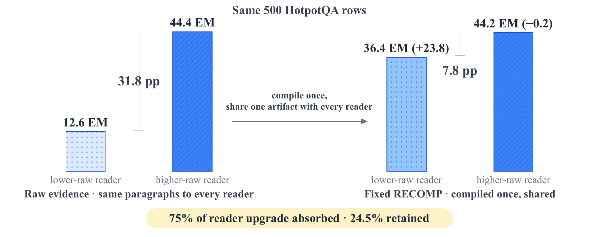

# ragscale

Many RAG systems shorten the retrieved passages with a compressor before the
answering model sees them. `ragscale` checks whether that compressor changes
how two answering models compare. Each model answers the same questions twice:
once with the raw passages and once with the same stored compressed text.
`ragscale` then reports how much of the raw gap between the two models is
still visible after compression.

The package accompanies the paper *[Compression Is Not Evaluation-Neutral:
Fixed RAG Compression Can Distort Reader Comparisons](https://arxiv.org/abs/2606.21807)*
(arXiv:2606.21807). It also ships the paper's 176,864-row interaction matrix,
which is on Hugging Face as
[vein05/ragscale-interaction-matrix](https://huggingface.co/datasets/vein05/ragscale-interaction-matrix).

## Overview

Start here:

- [What the paper found](#what-the-paper-found): the main result in one figure.
- [Install](#install): clone and install.
- [Quick start](#quick-start): a first run in one minute, with no API key.

Then pick your path:

| I want to... | Go to |
|---|---|
| Test my own compressor and models | [Audit your own pipeline](#audit-your-own-pipeline) |
| Try it on real data with only an API key | [Run with an API key](#run-with-an-api-key) |
| Analyze scores I already have | [Already have scores](#already-have-scores) |
| Use the paper's data | [Use the paper's data](#use-the-papers-data) |

Reference: [Terms](#terms), [Configuration](#configuration),
[Dataset format](#dataset-format), [Adapters](#adapters), [Scoring](#scoring),
[Reading the report](#reading-the-report), [Development](#development),
[Citation](#citation), [License](#license)

## Terms

| Term | Meaning |
|---|---|
| Reader | The model that answers the question from the evidence. |
| Compressor | The step that shortens or rewrites the retrieved passages, for example an LLM summary, RECOMP or LLMLingua. |
| Raw evidence | The retrieved passages before compression. |
| Upgrade | The score gap between a current reader and a candidate reader. |
| Upgrade retention | The upgrade under compressed evidence divided by the upgrade under raw evidence. A 10 pp raw upgrade that falls to 3 pp has 30% retention. |
| Rescue / damage | Compression *rescues* an answer that was wrong with raw evidence and becomes right. It *damages* an answer that was right and becomes wrong. |

## What the paper found



On 500 HotpotQA questions, the lowest- and highest-scoring readers are 31.8 pp
apart with raw passages. With one stored RECOMP compression, they are 7.8 pp
apart, so about 75% of the gap disappears. Every panel with at least eight
readers loses part of the gap, and how much depends on the compressor. A
compressor can raise average accuracy and still hide most of a reader upgrade.

So when you compare two readers behind a compressor, run both on raw evidence
and on the same stored compressed text, and report how much of the upgrade
survives. That is the audit `ragscale` runs. The numbers, controls and scope
are in the [paper](https://arxiv.org/abs/2606.21807).

## Install

`ragscale` needs Python 3.10 or newer. It is not on PyPI, so install it from
a clone:

```bash
git clone https://github.com/aimsresearchlab/ragscale.git
cd ragscale
python -m venv .venv
source .venv/bin/activate
python -m pip install -e .
```

## Quick start

```bash
ragscale init --output my-audit
ragscale run my-audit/ragscale.yaml
```

`init` writes a starter project with three files:

- `eval.jsonl`: two toy questions with their candidate passages;
- `adapters.py`: a toy compressor and two toy readers, written as plain
  Python functions;
- `ragscale.yaml`: the configuration that connects them.

`run` writes its results to `my-audit/audit/`. Open `REPORT.md` there. The
first table, **Decision summary**, has one row per metric:

| Column | Meaning |
|---|---|
| Current compression gain | Compressed minus raw score for the current reader. |
| Raw reader upgrade | Candidate minus current reader, with raw evidence. |
| Visible compressed upgrade | The same gap, with compressed evidence. |
| Upgrade retention | Compressed upgrade divided by raw upgrade. |
| Outcome | One of the four labels in [Reading the report](#reading-the-report). |

The toy run reports a 50 pp raw upgrade and a 0 pp compressed upgrade. That
comes from two hand-written questions and means nothing. It only shows that
the pipeline works end to end.

## Audit your own pipeline

1. Replace `eval.jsonl` with your questions and passages
   ([Dataset format](#dataset-format)).
2. Replace the three functions in `adapters.py` with wrappers around your
   compressor and your current and candidate readers ([Adapters](#adapters)).
3. Run `ragscale run my-audit/ragscale.yaml`.

The smallest configuration that runs names only the dataset, the compressor
and two readers:

```yaml
dataset:
  path: eval.jsonl
pipeline:
  compressor:
    callable: adapters:compress
readers:
  current:
    callable: adapters:current_reader
  candidate:
    callable: adapters:candidate_reader
```

Every other field has a default ([Configuration](#configuration)). To compare
more than two readers, add more entries under `readers`. The report's main
table still compares the two readers named in `comparison`, which default to
`current` and `candidate`.

If your models are behind an OpenAI-compatible API, you can skip the Python
adapters ([OpenAI-compatible endpoints](#openai-compatible-endpoints)).

## Run with an API key

With only an OpenRouter or OpenAI key, a preset runs the whole pipeline on
100 bundled HotpotQA questions:

```bash
export OPENROUTER_API_KEY=...
ragscale init --preset openrouter --output demo
ragscale run demo/ragscale.yaml
```

`--preset openai` does the same against `api.openai.com` with
`OPENAI_API_KEY`. The preset writes one LLM summary per question, runs two
hosted readers on raw and compressed evidence, and writes the report to
`demo/audit/`.

A 100-question run makes 100 compressor calls and 400 reader calls, plus 400
judge calls if the model judge is on. The committed example in
[`examples/openrouter-hotpotqa/`](examples/openrouter-hotpotqa/) took 2 minutes
20 seconds and reported $0.09 in cost. Calls run in parallel (`run.workers`).
Every answer is saved to `call_cache.jsonl`, so an interrupted run resumes
without repeating calls.

This run is an illustration on one fresh summary draw. It is not evidence
about other readers or compressors, and its report says so.

## Already have scores

If you already have each reader's score on raw and compressed evidence, skip
the pipeline:

```bash
ragscale replay-audit --input paired_scores.csv --metric exact_match --output audit/
```

The CSV needs one row per question and reader, with these columns:

| Column | Meaning |
|---|---|
| `example_id` | Question ID |
| `reader` | Reader name |
| `reader_family` | Model family of the reader |
| `raw_score` | Score with raw evidence, in [0, 1] |
| `compressed_score` | Score with compressed evidence, in [0, 1] |
| `candidate_pool_id` | ID of the passages the question was given |
| `compressed_artifact_hash` | Hash of the compressed text |
| `raw_policy_id` | Name of the raw evidence setup |
| `metric` | Metric name |

For each question, every reader must have the same `candidate_pool_id` and
`compressed_artifact_hash`. Every reader must cover the same questions. The
file needs at least two readers and one `raw_policy_id`. If it holds several
metrics, `--metric` picks one. The `paired_scores.csv` written by
`ragscale run` already has this format.

## Use the paper's data

The interaction matrix ships with the package:

```python
from ragscale import load_interaction_matrix

matrix = load_interaction_matrix()
```

The same file is on Hugging Face, byte-identical to
`data/interaction_matrix.csv.gz`:

```python
from datasets import load_dataset

matrix = load_dataset("vein05/ragscale-interaction-matrix", split="train")
```

Each row is one question, one reader and one evidence method, with the
reader's answer and a binary `correct` label. The columns are listed in
[`data/README_DATA.md`](data/README_DATA.md). For example, to compare each
reader's HotpotQA accuracy with raw top-k passages and with RECOMP:

```python
hotpot = matrix[matrix.dataset == "hotpotqa"]
accuracy = hotpot.pivot_table(
    index="reader_model", columns="method", values="correct", aggfunc="mean"
)
print(accuracy[["naive_top_k", "recomp_top5"]].sort_values("naive_top_k"))
```

Two rows with the same `method` label do not prove that two readers saw
byte-identical compressed text. The exact compressed texts and hashes behind
the paper's headline numbers are in
[`artifact/iclr_anonymous_artifact_2026-09-12.zip`](artifact/), with
`HEADLINE_FOOTPRINT_MANIFEST.md` and a `reproduce.py` script inside.

## Configuration

A full configuration with every field:

```yaml
version: 1

dataset:
  path: eval.jsonl
  name: production-support-qa
  description: Held-out tickets sampled from the last quarter.
  hint_fields: [question_type, domain, difficulty, tenant]
  minimum_slice_rows: 20
  hints:
    source: production-shadow-eval
    language: en

pipeline:
  raw_policy_id: retrieved-candidate-pool-v3
  compressor:
    id: deployed-summary-v7
    callable: adapters:compress

readers:
  current:
    name: deployed-reader
    family: model-family-a
    callable: adapters:current_reader
  candidate:
    name: candidate-reader
    family: model-family-b
    callable: adapters:candidate_reader

comparison:
  current: current
  candidate: candidate

scoring:
  metrics: [exact_match, token_f1, token_precision, token_recall]

run:
  output_dir: audit
  bootstrap_draws: 2000
  minimum_raw_gap: 0.05
  retention_alert_threshold: 0.75
  workers: 8
  store_artifact_text: true
  reuse_artifacts: true
  reuse_answers: true
  fail_on_outcomes: []
  seed: 20260821
```

| Field | Default | Meaning |
|---|---|---|
| `dataset.path` | required | JSONL file of questions ([Dataset format](#dataset-format)). |
| `dataset.name`, `description`, `hints` | none | Labels copied into the report. |
| `dataset.hint_fields` | `[question_type]` | Fields used to split results into slices. |
| `dataset.minimum_slice_rows` | 10 | A slice needs this many questions to get its own row in the report. |
| `pipeline.raw_policy_id` | `raw-evidence-v1` | Name for how the raw passages were retrieved. |
| `pipeline.compressor` | required | The compressor adapter, plus an optional `id`. |
| `readers` | required, at least two | One entry per reader: an adapter, plus an optional `name` and `family`. |
| `comparison` | `current`, `candidate` | The two reader keys compared in the main table. |
| `scoring.metrics` | `[exact_match, token_f1]` | Metrics to compute ([Scoring](#scoring)). |
| `run.output_dir` | `ragscale-audit` | Where results go, relative to the YAML file. |
| `run.bootstrap_draws` | 2000 | Resamples used for the intervals. |
| `run.minimum_raw_gap` | 0.05 | A raw upgrade smaller than this is reported as `insufficient-raw-separation`. |
| `run.retention_alert_threshold` | 0.75 | Retention below this is flagged in the report. No threshold has been validated as a pass or fail rule. |
| `run.workers` | 1 | How many adapter calls run at once. |
| `run.store_artifact_text` | true | Save the compressed text, not only its hash. |
| `run.reuse_artifacts` | true | Reuse compressed texts from `artifact_manifest.jsonl`. The run stops if the passages, raw evidence or compressor configuration changed. |
| `run.reuse_answers` | true | Reuse reader and judge answers from `call_cache.jsonl`. |
| `run.fail_on_outcomes` | `[]` | Outcomes that make the command exit with status 2, for CI. |
| `run.seed` | 20260821 | Random seed. |

Paths and adapter imports are resolved from the YAML file's folder.

For CI, list the outcomes that should fail the job:

```yaml
run:
  fail_on_outcomes:
    - observed-order-reversed
    - observed-upgrade-attenuated
    - insufficient-raw-separation
```

## Dataset format

Each JSONL line is one question:

```json
{
  "example_id": "ticket-1042",
  "question": "How long does a refund take?",
  "reference_answers": ["Five to ten business days"],
  "candidate_pool": [
    {"id": "policy-7", "text": "Refunds take five to ten business days."}
  ],
  "question_type": "policy_lookup",
  "domain": "billing",
  "difficulty": "easy",
  "tags": ["refund"],
  "hints": {"tenant": "north-america", "channel": "chat"}
}
```

`example_id`, `question`, `reference_answers` and `candidate_pool` are
required. `question_type`, `domain`, `difficulty` and any hint fields are
carried into the report as slices.

## Adapters

Adapters are plain Python functions. A compressor may take any of
`question`, `documents`, `evidence`, `metadata` and `case`:

```python
def compress(question, documents, metadata):
    text = deployed_compressor(question, documents)
    return {"text": text, "tokens": 412, "cost_usd": 0.0017}
```

A reader may take any of `question`, `evidence`, `metadata`, `case` and
`condition`:

```python
def candidate_reader(question, evidence, metadata, condition):
    answer = deployed_reader(question=question, context=evidence)
    return {"answer": answer, "tokens": 86, "cost_usd": 0.0021}
```

An adapter can return a string or a dictionary with `text`, `answer` or
`output`. Optional `tokens`, `cost_usd` and `metadata` feed the resource
summary. Latency is measured automatically.

The compressor runs once per question. `ragscale` stores a hash of its output
and gives the same compressed text to every reader. Two assumptions are not
checked:

- The raw branch gives the reader the joined candidate passages in the same
  prompt template as the compressed branch. If your production raw path
  formats evidence differently, rebuild it in a Python adapter from `case`.
- The compressor must not know which reader it serves. A reader-specific
  compressor breaks the design, and the runner cannot detect it.

### OpenAI-compatible endpoints

Use `type: openai_compatible` to call a Chat Completions API without writing
Python adapters. The API key is read from the named environment variable.

```yaml
pipeline:
  raw_policy_id: retrieved-candidate-pool-v3
  compressor:
    id: deployed-summary-v7
    type: openai_compatible
    model: provider/compressor-model
    base_url: https://openrouter.ai/api/v1
    api_key_env: OPENROUTER_API_KEY
    parameters:
      temperature: 0

readers:
  current:
    name: deployed-reader
    family: model-family-a
    type: openai_compatible
    model: provider/current-model
    base_url: https://openrouter.ai/api/v1
    api_key_env: OPENROUTER_API_KEY
  candidate:
    name: candidate-reader
    family: model-family-b
    type: openai_compatible
    model: provider/candidate-model
    base_url: https://openrouter.ai/api/v1
    api_key_env: OPENROUTER_API_KEY
```

- Omit `base_url` to use `https://api.openai.com/v1` with `OPENAI_API_KEY`.
- Optional fields: `system_prompt`, `user_prompt_template`, `headers`,
  `timeout`, `max_retries` and `parameters`. Prompt templates may use
  `{question}`, `{evidence}` and `{condition}`.
- Set `temperature: 0` for every hosted adapter. Otherwise reader noise mixes
  with the compression effect.
- On OpenRouter, `parameters.extra_body.provider` pins the serving provider,
  so the raw and compressed runs hit the same backend.
- Reasoning models can spend the whole `max_tokens` budget on hidden thinking
  and return no text. An empty reply is retried twice (`empty_retries`). A
  reader that still returns nothing scores zero and is marked
  `empty_response: true`. An empty compressor or judge reply stops the run.
- Rate limits are retried with exponential backoff (`rate_limit_retries`).
- The audit records the endpoint, the requested and returned model names, the
  serving provider when reported, the response ID, a prompt hash and token
  usage. It never writes the API key.

## Scoring

Built-in metrics: `exact_match` (or `em`), `token_f1` (or `f1`),
`token_precision`, `token_recall`, `rouge_l` and `answer_contains`. Exact match
and the token metrics lowercase the text, remove punctuation, articles and
extra spaces, and take the best score over all reference answers.

Lexical metrics also punish answer style. A reader that answers in full
sentences loses exact match to one that gives only the span, and compression
can change style as well as content. The default reader prompt asks for the
answer span only. For readers that still explain, add the model judge or a
custom metric.

A custom metric is a function that takes `prediction`, `references` and
`case` and returns a score in [0, 1]:

```yaml
scoring:
  metrics:
    - exact_match
    - name: grounded_correctness
      callable: my_metrics:grounded_correctness
```

### Model judge

An OpenAI-compatible judge scores each answer 0 or 1 against the references:

```yaml
scoring:
  metrics:
    - exact_match
    - name: judge_match
      type: openai_compatible
      model: openai/gpt-4.1-mini
      base_url: https://openrouter.ai/api/v1
      api_key_env: OPENROUTER_API_KEY
      parameters:
        temperature: 0
        max_tokens: 4
```

The judge sees the question, the reference answers and the prediction. It
never sees the evidence, so it cannot reward an answer for copying the
compressed text. A reply that is not 0 or 1 raises an error. Judge calls are
cached like reader calls.

## Reading the report

`ragscale run` writes these files to the output folder:

- `REPORT.md` and `report.html`: the report;
- `summary.json`: the same results in machine-readable form;
- `paired_scores.csv`: one row per question, reader and metric, the input
  format for `replay-audit`;
- `records.jsonl`: scores, answers, hints, provenance, latency, tokens and
  reported cost;
- `artifact_manifest.jsonl`: hashes of the passages and compressed texts,
  written before any reader runs.

The report keeps two questions apart:

1. **Compression gain:** does the compressor help the current reader?
2. **Upgrade retention:** how much of the upgrade from the current to the
   candidate reader is still visible under compression?

Each metric gets one outcome:

| Outcome | Meaning |
|---|---|
| `observed-upgrade-preserved` | Retention is at or above `retention_alert_threshold`. |
| `observed-upgrade-attenuated` | The upgrade keeps its direction but retention is below the threshold. |
| `observed-order-reversed` | The candidate wins on raw evidence and loses on compressed evidence, or the reverse. |
| `insufficient-raw-separation` | The raw upgrade is smaller than `minimum_raw_gap`, so retention is not computed. |

The report also shows intervals, rescue and damage rates for each reader,
results by slice, the questions whose outcome changed, and resource use.
Results describe the readers, questions and compressed texts you supplied.
`ragscale` gives no verdict about other readers or future compressor runs.

## Development

```bash
python -m pip install -e ".[dev]"
python -m pytest -q
python -m pip wheel . --no-deps --wheel-dir dist
```

The CLI has three commands: `init`, `run` and `replay-audit`.

| File | Role |
|---|---|
| `config.py` | Loads the YAML. |
| `execute.py` | Compresses once per question and runs the readers. |
| `analysis.py` | Computes the pair statistics. |
| `reports.py` | Writes the outputs. |
| `presets.py` | Holds the starter projects. |
| `runner.py` | Connects the stages. |
| `replay.py` | The panel audit used to validate the paper; its statistics are unchanged since 0.2.0. |

## Citation

```bibtex
@misc{panthi2026ragcompression,
  title         = {Compression Is Not Evaluation-Neutral: Fixed {RAG} Compression Can Distort Reader Comparisons},
  author        = {Panthi, Sugam and Abdelfattah, Rabab},
  year          = {2026},
  eprint        = {2606.21807},
  archivePrefix = {arXiv},
  primaryClass  = {cs.CL},
  doi           = {10.48550/arXiv.2606.21807},
  url           = {https://arxiv.org/abs/2606.21807}
}
```

## License

Code is released under Apache 2.0. The interaction matrix derives from
separately cited public benchmarks and stored model outputs. Benchmark content
remains subject to its source license and terms.
